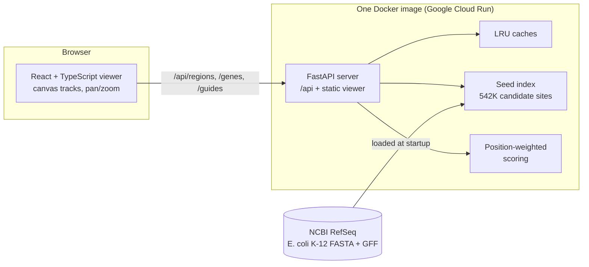

# GUIDR

**CRISPR guide RNA design with genome-wide off-target search and an interactive genome viewer.**

Live demo: <https://guidr-999781595196.us-central1.run.app> (the first visit after a quiet period takes about 6 seconds while the server loads the genome and builds its index)

## What it does

CRISPR-Cas9 edits DNA by cutting where a 20-letter *guide* sequence matches the genome, next to an `NGG` motif. A good guide matches one place only. If near-copies exist elsewhere (*off-targets*), the edit can cut there by accident.

GUIDR takes a gene from the *E. coli* K-12 genome, lists every candidate guide inside it, searches the whole genome for near-copies of each guide (up to 3 letter substitutions, both strands), scores each guide, and shows the results in a browser viewer you can pan and zoom.

- Search a gene (name, locus tag) or a region, then pan, zoom, and click through from genes to guides to off-targets.
- **Compute guides** scores every guide in a gene; guides are colored by score.
- Each guide's off-targets are listed most dangerous first, with the mismatched letters highlighted and a **Jump** button.

## Architecture



The server builds its search index once at startup (about 4 seconds), keeps everything in memory, and serves the built viewer and the API from one origin, so there is no CORS setup.

## How it works

### 1. Finding every site
A *site* is a 20-letter protospacer followed by `NGG`. Sliding a 23-letter window over the genome and keeping windows that end in `GG` (forward strand) or start with `CC` (reverse strand) gives 542,072 sites in *E. coli* (4.64 M letters). Coordinates are 0-based half-open internally.

### 2. A brute-force oracle, then a fast index
The first version compares a guide against every site (410 ms per guide). It stays in the repository as the **oracle**: deliberately simple, so it can be trusted as ground truth.

The fast version is a **seed-and-extend index** built on the pigeonhole principle. With up to *k* allowed mismatches, each 20-letter site is cut into *k + 1* pieces; *k* mismatches can spoil at most *k* pieces, so every true off-target matches at least one piece exactly. The index keeps one table per piece position (piece letters to the sites that have them). A query looks up one bucket per piece, merges the candidates, and verifies each one with a full comparison. On lacZ a guide needs about 2,800 verifications instead of 542,072.

### 3. Scoring (a documented heuristic)
Mismatches near the PAM make Cas9 less likely to cut, so position matters. For one off-target, `r = 100 × Π (20 − i) / 21` over its mismatched positions `i` (position 19 touches the PAM). A guide's combined risk is `g = sqrt(Σ r²)` and its score is `G = 10000 / (100 + g)`, from 0 to 100 (higher is safer). The rule is a simplified placeholder, **not experimentally validated**, and every score should be read as a relative ranking.

### 4. The API
| Endpoint | Returns |
|---|---|
| `GET /api/info` | settings, chromosomes, cache statistics |
| `GET /api/genes/{name}` | a gene's coordinates (name, locus tag, or ID) |
| `GET /api/genes/{name}/guides?limit=&offset=` | the gene's guides ranked by score, paged |
| `GET /api/regions?chrom=&start=&end=` | genes plus guides (up to 5,000 letters) or 200 density bins |
| `GET /api/guides/offtargets?chrom=&start=&strand=` | one guide with its off-targets, most dangerous first |

Coordinates in requests and responses are 1-based inclusive. Results are cached in LRU caches (a gene's full ranked list is cached once and every page is a slice of it); a cache that is asked for the same missing key by several requests at once computes it only once.

### 5. The viewer
A React + TypeScript app drawing on an HTML canvas. The coordinate math (pixels to positions, pan, zoom around the cursor, request windows) lives in a pure module with its own tests. A region loader debounces requests, cancels stale ones with `AbortController`, and ignores late answers; a client-side LRU cache serves repeated requests.

## Results

Measured on a MacBook Air (Apple silicon) with the *E. coli* K-12 MG1655 genome (4.64 M letters, 542,072 candidate sites); the benchmark client ran on the same machine as the server. Scripts: `scripts/benchmark_api.py`, `scripts/measure_startup.py`.

### Off-target search
| | Brute-force reference | Seed index |
|---|---:|---:|
| Time per guide | 410 ms | **3.6 ms (115x)** |
| Full lacZ gene (415 guides) | 172 s | **5.1 s** |
| Sites verified per guide | 542,072 | about 2,820 |

The index returned results identical to the oracle for all 415 guides of lacZ (index build: 0.57 s).

### API
| Request | p50 | p95 |
|---|---:|---:|
| Gene lookup | 1.8 ms | 2.8 ms |
| Gene guides, first request (scores every guide) | 468 ms | 1.5 s |
| Gene guides, cached | 2.8 ms | 8.1 ms |
| Region, 3 kb | 6.6 ms | 7.4 ms |
| Off-targets, first request / cached | 5.0 ms / 1.2 ms | 6.5 ms / 1.3 ms |

Under load (8 parallel clients, 800 cached requests, 0 errors): **391 requests/s, p99 67 ms**. A 3 kb region costs about the same cached or not, because JSON encoding dominates; the cache matters for gene guides. The benchmark found that gene lookup was scanning all 4,600 genes on every request; indexing names once at startup cut it from 12.7 ms to 1.8 ms and raised load throughput from 176 to 391 requests/s.

### Startup and deployment
- Ready in 3.7 s (median of 3 runs) with 334 MB resident memory.
- Deployed on Google Cloud Run with scale to zero. After 20+ minutes idle the first request takes **5.7 s** (median of 16 cold starts, typically 5.4 to 6.1 s; see `cold_start.log`). Warm requests take about 100 ms from my laptop, mostly network latency.

## Validation

I spot-checked six lacZ guides against [CRISPOR](https://crispor.gi.ucsc.edu) (genome: *E. coli* K-12 MG1655), comparing sites next to an `NGG` motif with 0 to 3 mismatches. Four guides were chosen because GUIDR reports an off-target for them, two because it reports none (`scripts/pick_validation_guides.py` selects the guides and prepares the sequences).

| Guide (1-based, strand) | GUIDR off-targets (0 / 1 / 2 / 3 mismatches) | CRISPOR (0 / 1 / 2 / 3 mismatches) |
|---|:---:|:---:|
| NC_000913.3:365,691-365,713 (-) | 0 / 1 / 0 / 0 | 0 / 1 / 0 / 0 |
| NC_000913.3:363,862-363,884 (-) | 0 / 0 / 0 / 1 | 0 / 0 / 0 / 1 |
| NC_000913.3:364,915-364,937 (-) | 0 / 1 / 0 / 0 | 0 / 1 / 0 / 0 |
| NC_000913.3:363,440-363,462 (+) | 0 / 0 / 0 / 1 | 0 / 0 / 0 / 1 |
| NC_000913.3:363,233-363,255 (+) | 0 / 0 / 0 / 0 | 0 / 0 / 0 / 0 |
| NC_000913.3:363,239-363,261 (+) | 0 / 0 / 0 / 0 | 0 / 0 / 0 / 0 |

The counts, the strands, and the 23-letter spans agreed for all six guides, including all four off-target sites.

This is a small spot check, and it covers only what GUIDR searches (substitutions, `NGG`, up to 3 mismatches; see Limits). It checks the search, not the biological accuracy of the score.

The search is also checked by tests: the index must return exactly the oracle's results (compared as sets of location, strand, and mismatch count) on seeded random genomes with planted near-copies at several mismatch limits, and on all 415 guides of lacZ.

## Testing

- **150+ Python tests** (pytest) and **110+ TypeScript tests** (Vitest).
- **Differential tests** compare the fast index with the brute-force oracle; **property tests** check the scoring rule (more mismatches never raise risk, moving a mismatch toward the PAM never raises it, bounds, determinism).
- The API tests build the whole app on a tiny made-up genome whose off-targets were worked out by hand.
- The test suites were themselves checked by deliberately injecting bugs (wrong strand handling, off-by-one coordinates, a cache that evicts the wrong entry, stale responses, and others) and confirming the tests fail.

## Limits

- Substitutions only (no insertions or deletions/bulges); the `NGG` motif only (no weaker `NAG`); up to 3 mismatches by default.
- The score is a simplified heuristic, not experimentally validated, and has no on-target efficiency model.
- Tested on one genome (*E. coli* K-12). The viewer shows the first chromosome and treats the circular chromosome as linear.
- A cold start takes about 6 seconds because the index is built at startup (saving it to disk is a possible improvement).
- At full zoom-out the region response includes every gene in view (about 4,300), which makes it larger than necessary.

## Run it locally

```bash
python3 -m venv .venv && source .venv/bin/activate
pip install -e ".[dev]"
pytest

# data: E. coli K-12 MG1655 from NCBI RefSeq (GCF_000005845.2)
mkdir -p data && cd data
curl -O https://ftp.ncbi.nlm.nih.gov/genomes/all/GCF/000/005/845/GCF_000005845.2_ASM584v2/GCF_000005845.2_ASM584v2_genomic.fna.gz
curl -O https://ftp.ncbi.nlm.nih.gov/genomes/all/GCF/000/005/845/GCF_000005845.2_ASM584v2/GCF_000005845.2_ASM584v2_genomic.gff.gz
cd ..

# command line
guidr --fasta data/GCF_000005845.2_ASM584v2_genomic.fna.gz --gff data/GCF_000005845.2_ASM584v2_genomic.gff.gz --gene lacZ --max-guides 25

# API
GUIDR_FASTA=data/GCF_000005845.2_ASM584v2_genomic.fna.gz GUIDR_GFF=data/GCF_000005845.2_ASM584v2_genomic.gff.gz \
  uvicorn --factory guidr.api:app_from_env --port 8000

# viewer (a second terminal; it proxies /api to the server on port 8000)
cd viewer && npm install && npm run dev        # http://localhost:5173
```

Or in one container: `docker build -t guidr . && docker run --rm -p 8080:8080 guidr`, then open <http://localhost:8080>.

## Deploy (Google Cloud Run)

```bash
gcloud run deploy guidr --source . --region us-central1 --memory 1Gi --cpu 1 --max-instances 1 --allow-unauthenticated
```

## Future work

* Insertions and deletions in the index
* Weaker PAMs
* Published position weights for the score (with citation)
* Saving the index to disk to shorten cold starts
* Capping genes returned at wide zoom
* More genomes
* A gene-search endpoint with autocomplete.